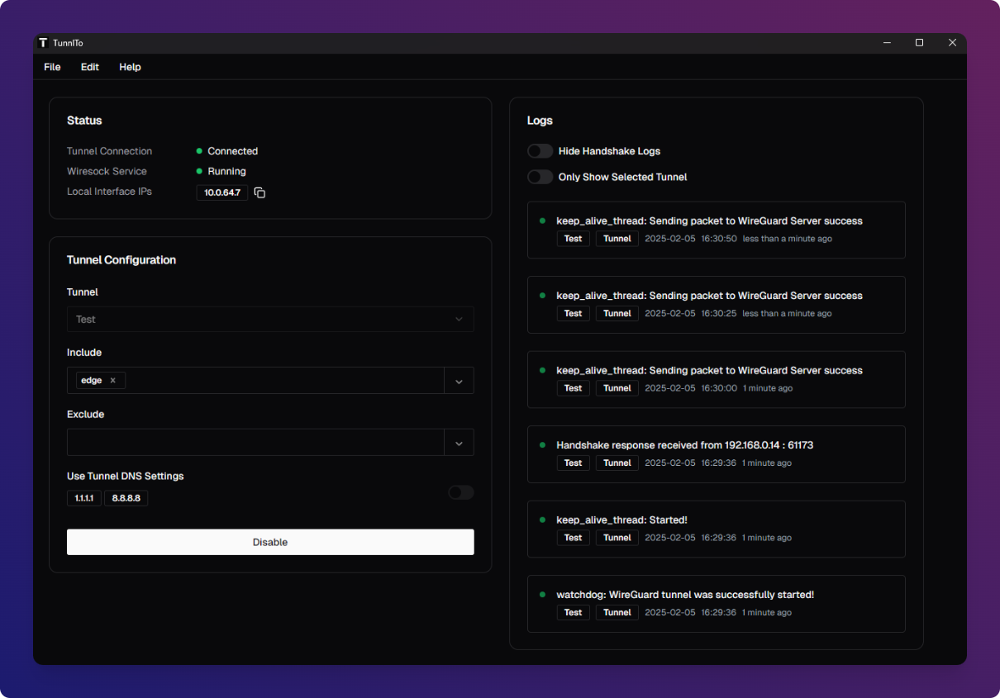
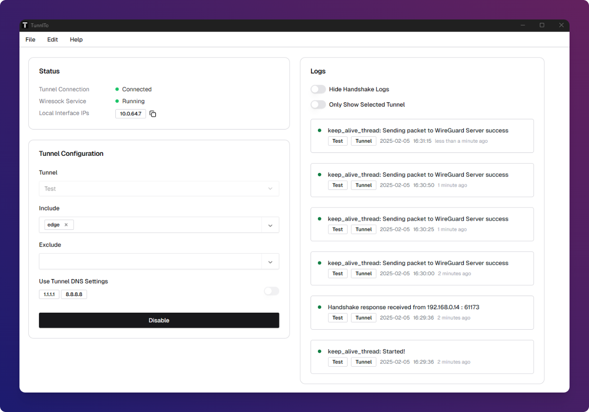
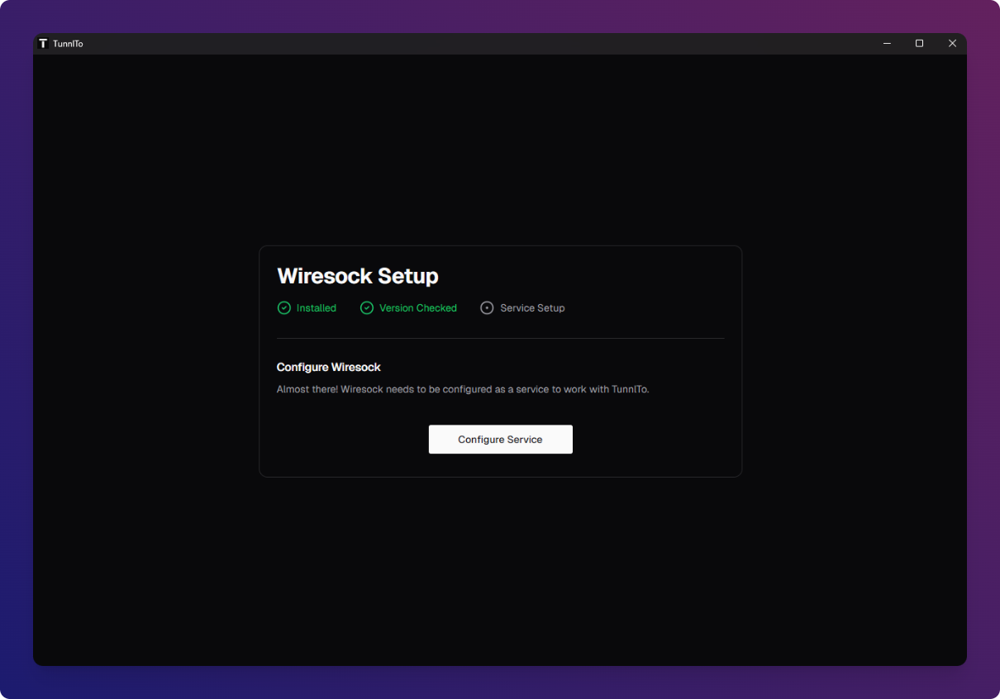
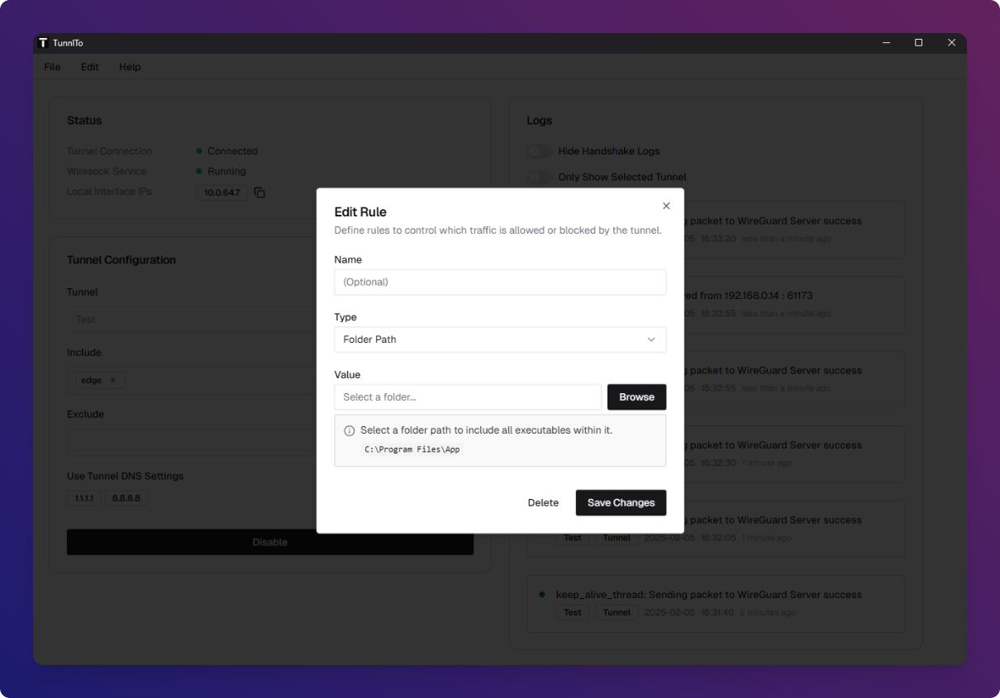
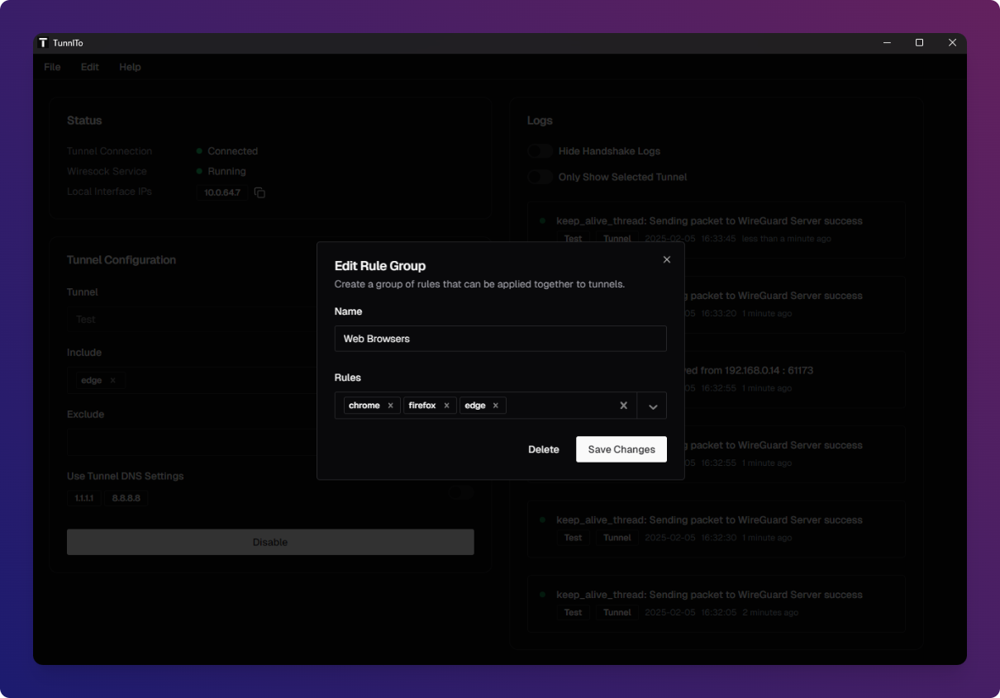
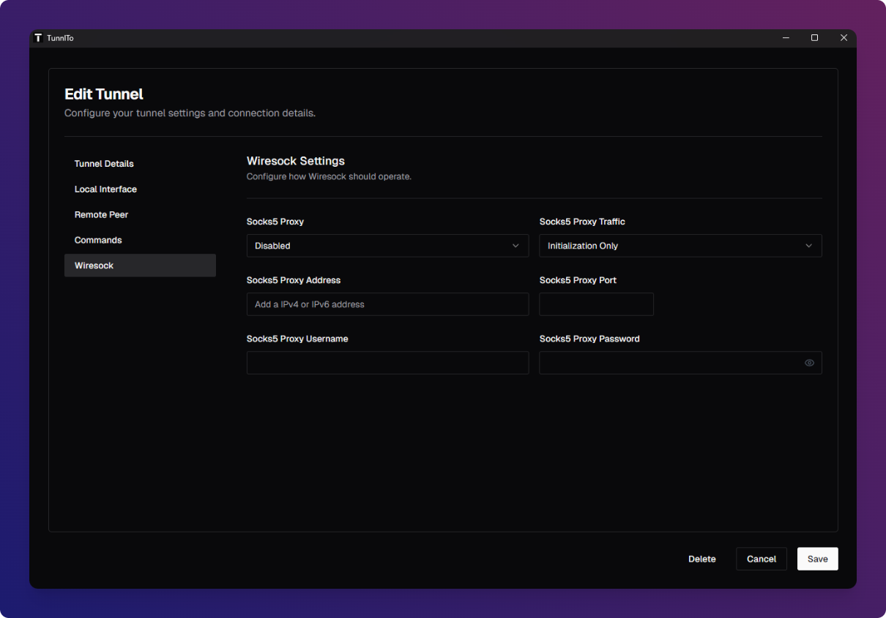
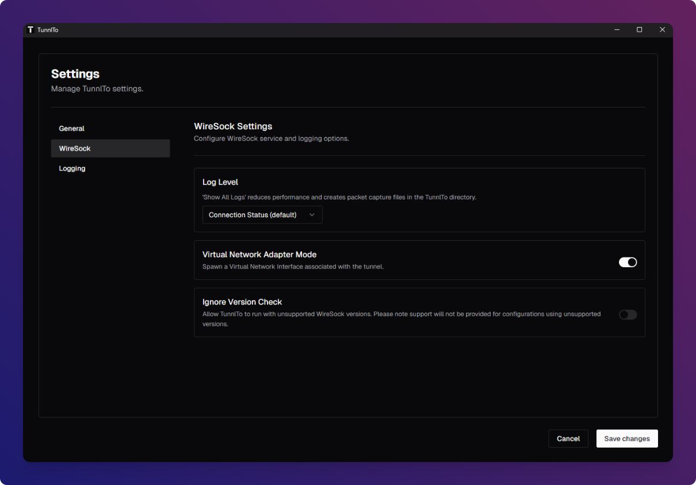

# TunnlTo

> [!TIP]
> **🆕 Meet [Rouler](https://rouler.io/?utm_source=github&utm_medium=referral): Rules for your routes.**
> Send each app, IP or subnet out the network interface you choose. Free public beta for Windows.
>
> 

## 🔗 Official Links
- [Official TunnlTo website](https://tunnl.to)
- [TunnlTo on X](https://x.com/TunnlTo)

